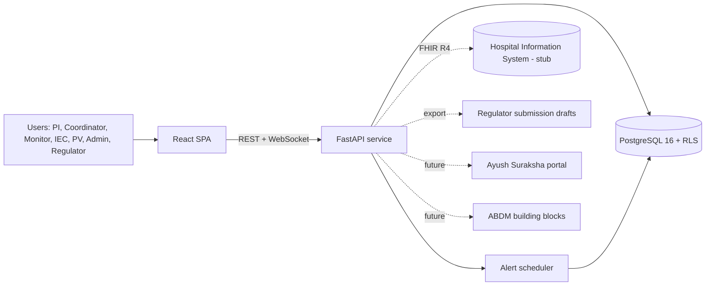
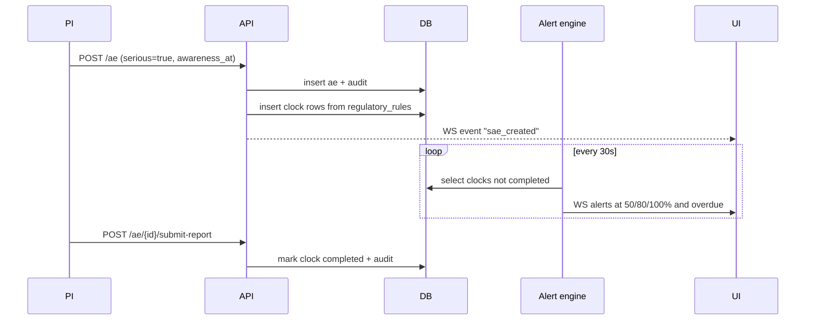
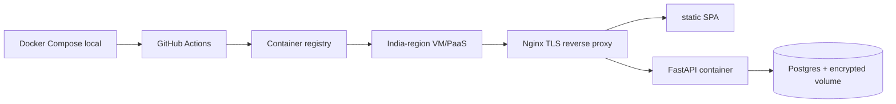

# 02 — Architecture & Design

## 1. System context


## 2. Components
| Component | Responsibility |
|---|---|
| SPA (React) | Role-tailored dashboards, forms, live alerts |
| API (FastAPI) | Auth, RBAC, business rules, exports |
| Audit service (module) | Writes hash-chained audit rows in same DB transaction |
| Rule/alert engine | Evaluates KPI thresholds and regulatory clocks (APScheduler tick every 30 s + event-triggered) |
| Export module | FHIR bundle builder, SDTM CSV writer |
| DB | Relational store, RLS for site isolation, triggers for audit immutability |

## 3. Layered backend structure
```
app/
  main.py
  core/        config.py security.py deps.py db.py
  models/      SQLAlchemy models
  schemas/     Pydantic request/response
  routers/     auth studies participants visits deviations queries ae dashboard audit admin export
  services/    lifecycle.py clocks.py alerts.py audit.py fhir.py sdtm.py consent.py
  rules/       regulatory_defaults.json
  tests/
```

## 4. Key flows

### 4.1 Login & RBAC
1. POST /auth/login -> verify argon2 -> issue JWT with `sub`, `role`, `site_ids`.
2. Dependency `require(permission)` checks role-permission map (single source: `permissions.py`).
3. Each request sets `SET LOCAL app.user_id, app.role, app.site_ids` so Postgres RLS policies apply.

### 4.2 Audited write (pattern for every mutating endpoint)
```
BEGIN
  apply change
  audit.write(actor, action, entity, entity_id, before, after, reason)
COMMIT
```
`audit.write`: takes advisory lock, reads last `row_hash`, computes
`row_hash = SHA256(prev_hash || canonical_json(payload) || timestamp)`, inserts.

### 4.3 SAE clock


### 4.4 Lifecycle guard
`lifecycle.transition(study, target)` verifies allowed edges and preconditions (EC valid, CTRI number present, sites active); raises 409 otherwise; audits.

### 4.5 Export
- FHIR: map rows to `ResearchStudy`, `ResearchSubject`, `Patient` (pseudonym ID only), `AdverseEvent`; validate with `fhir.resources` before returning.
- SDTM: build DM and AE dataframes per mapping in doc 05; CSV with headers `STUDYID, DOMAIN, USUBJID, ...`.

## 5. Security design
| Threat | Control |
|---|---|
| Credential theft | argon2id, lockout, optional TOTP, short-lived JWT |
| Privilege escalation | Deny-by-default permission map + RLS + tests per role |
| PII leakage | Split `participant_pii` table, pgcrypto column encryption, masked serializers, pseudonymised exports |
| Audit tampering | Append-only trigger, revoked UPDATE/DELETE, hash chain, verify endpoint |
| Injection/XSS | ORM parameterisation, Pydantic validation, React escaping, CSP header |
| Abuse | Rate limiting on auth and export endpoints |
| Secrets | Env vars, `.env` not committed |

## 6. Data model overview
See `03-database-schema.sql`. Core entities: users, sites, user_sites, studies, study_sites, study_milestones, ethics_approvals, ctri_registrations, participants, participant_pii, consents, visits, crf_entries, deviations, queries, adverse_events, ae_clocks, regulatory_rules, alerts, kpi_config, audit_log, coding lookups.

## 7. Alert engine design
Rule types:
- `ENROLMENT_LAG`: enrolled/target below expected by elapsed-time fraction minus tolerance
- `EC_EXPIRY`: approval valid_to within N days
- `CTRI_UPDATE_DUE`: ctri last_updated older than N days (config)
- `MONITORING_OVERDUE`: last monitoring visit older than N days
- `QUERY_AGEING`: open queries older than N days
- `SAE_CLOCK`: from `ae_clocks`
Dedup key `(rule_type, entity_id, threshold_level)` prevents repeat alerts.

## 8. Deployment

- Compose services: `db`, `api`, `web`, `nginx`.
- Backups: nightly `pg_dump` to encrypted storage (state in deck as production plan).
- Production hardening list (roadmap): WAF, CERT-In empanelled audit, ISO 27001 aligned ops, NIC/MeghRaj hosting.

## 9. Frontend design
- Routes per role: `/pi`, `/coordinator`, `/monitor`, `/iec`, `/pv`, `/admin`, `/regulator`; shared `/studies/:id`.
- Global alert bell driven by WebSocket.
- Design tokens: teal/green Ayush-appropriate palette, red for SAE/overdue, high-contrast text.
- Components: KPI card, lifecycle stepper, enrolment chart, SAE clock chip, audit table with verify badge, role-guarded route wrapper.

## 10. Design decisions & trade-offs
| Decision | Rationale | Trade-off |
|---|---|---|
| Monolith FastAPI | Speed in 36h | Less scalable; describe microservice split as roadmap |
| Hash chain in Postgres, not blockchain | Simple, verifiable, no infra | Not distributed trust; mention anchoring option |
| CRF as JSON schema | Flexible, quick | Weaker validation than full EDC |
| Stub dictionaries | Avoids licence issue | Coding not production-grade |
